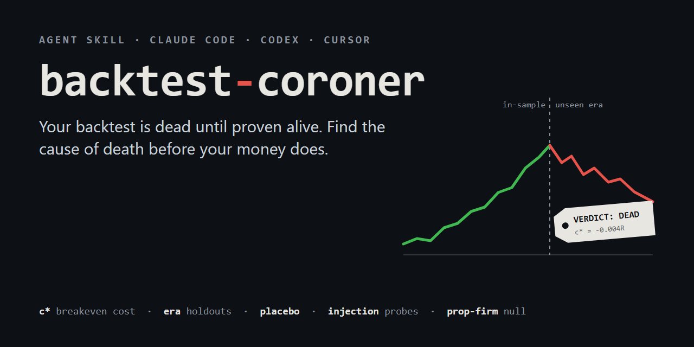

<p align="center"></p>

<p align="center">
<a href="LICENSE"></a>


</p>

**backtest-coroner** is an agent skill (Claude Code, Codex, Cursor, Gemini CLI, anything that
reads `SKILL.md`) plus a zero-dependency Python CLI that does to your trading backtest what a
coroner does to a body: **find the cause of death before your money does.**

Ask your AI to "check my backtest" and, instead of a cheerful "looks promising!", it runs a
falsification protocol: era-separated holdouts, the breakeven cost `c*`, a 2,000-seed random-direction
placebo, injection probes that prove your engine can actually see an edge, and, if you are aiming
at a funded account, the prop-firm's real null (a coin flip under the firm's rules pays more than $0).

> Built from about **99 strategy families** I took through a pre-registered protocol with Claude Code
> and killed one by one: ORB, VWAP, scalping, ML filters, calendar effects, order flow, insider
> filings, cross-sectional factors, prop-firm sizing. Every rule in the skill carries the number that
> produced it. Most of what you will read here was learned by being wrong first.

---

## Thirty seconds: the strategy that looks like a winner

A synthetic breakout strategy (2R target, real cost) backtested on 2021-2024 only:

```
$ python coroner.py autopsy recent_only.csv
trades 919   span 2021-01-01 .. 2024-12-31 (4.0 y)   230 trades/y
net/trade +0.1578   t(net) +3.25   annualised Sharpe +1.63

DEATH CERTIFICATE   verdict: SUSPECT
[SUSPECT] rule 1  whole sample is 4.0 years = one market era. Any holdout cut
                  inside it is not a holdout. Add older data before trusting a PASS.
```

t = +3.25, a positive holdout, four green years. Most tools would stop here. The coroner asks for
older data. Same rules, 2010-2025:

```
$ python coroner.py autopsy full_history.csv
breakeven cost c* (t gate 3): -0.0036 per trade, you pay 0.0500

era                        n     gross     net      t(net)  years+
2010-01-04..2015-05-04    1241  +0.0177  -0.0323   -0.80   4/6
2015-05-05..2020-09-01    1226  +0.0400  -0.0100   -0.25   4/6
2020-09-02..2025-12-31    1235  +0.1441  +0.0941   +2.27   5/6

DEATH CERTIFICATE   verdict: DEAD
[DEAD] rule 15  c* = -0.0036 < 0: fails the t gate even at ZERO cost.
                No broker, venue or rebate fixes a missing signal.
[DEAD] rule  1  the edge lives in ONE era and is flat/negative in another.
                Same-era holdouts cannot see this; out-of-era data will.
```

This is not hypothetical. A real opening range breakout went **t = +3.73 over 2021-2024 → expR
−0.043, 3/11 positive years on 10.5 unseen years.** ([case file 1](skills/backtest-coroner/references/graveyard.md))

---

## Install

**Claude Code** (plugin):
```
/plugin marketplace add Cezart3/backtest-coroner
/plugin install backtest-coroner@backtest-coroner
```

**Any agent** (Claude Code, Codex, Cursor, Gemini CLI, OpenCode, ...) via the open skills CLI:
```
npx skills add Cezart3/backtest-coroner
```

**Manual:** copy `skills/backtest-coroner/` into your agent's skills folder
(`~/.claude/skills/`, `~/.codex/skills/`, ...).

**Just the CLI** (Python 3.10+, no dependencies):
```
python skills/backtest-coroner/scripts/coroner.py --help
```

Then talk to your agent normally: *"here's my backtest, is the edge real?"*, *"will this pass an
FTMO / Topstep / FundedNext challenge?"*, *"optimise my stop loss"*. The skill triggers on its own.

---

## What the agent does with it

| stage | what it checks | rule it enforces |
|---|---|---|
| **0 Intake** | data, bar size, cost model, what was already looked at | anything seen is in-sample |
| **1 Apparatus gate** | lookahead, same-bar fills, learned sign on net, cost model on a known truth, clock/time zone, survivorship | a fake edge is usually a bug |
| **2 Arithmetic kill** | `c* = g − T·s/√n`, breakeven win rate | kill before you code |
| **3 Autopsy** | eras, holdout decay, years positive, continuous maxDD, random-direction placebo | a same-era holdout is not a holdout |
| **4 Injection** | plants a known drift in your prices; your engine must find it | a negative means nothing until this passes |
| **5 Prop economics** | your account program vs a coin flip under the same firm rules | the null is the structure, not $0 |
| **6 Pre-registration** | hypothesis, cells, gates and kill conditions written before the run | no tuning on the holdout |

It ends every assessment with a death certificate:

```
VERDICT: DEAD | SUSPECT | VOID | ALIVE (provisional)
CAUSE OF DEATH: <one line, with the number>
CONTRIBUTING FACTORS: <rule id + number>
WHAT WOULD CHANGE THE VERDICT: <the cheapest measurement that could overturn it>
NOT CHECKED: <stages skipped and why>
```

## The CLI

Trades CSV: `date,gross,cost` (R multiples recommended), optional `mae,mfe` for intraday excursions.

```bash
# death certificate
coroner.py autopsy trades.csv --eras 2010-2015,2016-2020,2021-2025 --holdout-from 2023-01-01

# prop account program vs random-direction null (2,000 seeds)
coroner.py prop trades.csv --balance 100000 --risk 0.01 --targets 0.08,0.05 \
  --max-dd 0.10 --dd-type static --daily-loss 0.05 --fee 540 --payout-at 0.03 --split 0.8

# plant 1 ATR of drift after every signal bar, then run YOUR engine on the output
coroner.py inject prices.csv --out injected.csv --drift-atr 1.0 --bars 12

# what win rate does a 2R bracket need after 0.05R of cost?
coroner.py breakeven --rr 2 --cost 0.05
```

`prop` on the synthetic history, on a two-step 100k account:

```
REAL      accounts bought 47  funded 18  blown 46  payouts 51
          withdrawn $156,960  fees $25,380  NET $131,580  ($686/month over 192 months)
NULL      random direction, same days, same cost, 2000 seeds
          net mean $41,785   null beats its fees in 94.3% of seeds
[STRUCTURE] the account rules pay a coin flip on average. Your bar is the null
            ($41,785), not $0. Only the part above it is edge.
[REGIME] 7/16 calendar years lose money.
```

## A few of the rules

- **A holdout in the same era as the in-sample is not a holdout.** t = +3.73 bought zero on 10.5 unseen years.
- **Multiply a learned sign into gross, never into net.** `sign * net` turned cost into profit: Sharpe 3.79, 19/19 green years, all fake.
- **Limit entries must be resolved on finer data than the signal bar.** 71.7% of a "universal" VWAP edge's wins had the target printed *before* the entry.
- **Controls catch false positives; only injection catches false negatives.** A bug that destroys an edge looks exactly like an honest negative.
- **√N multiplies zero.** 245,000 scalping trades, best cell +0.0198 R at t 1.87, *before* cost.
- **Cost grows faster than signal down the liquidity ladder.** Net +8.99 → +4.30 → −12.53 bps/day as names get smaller and the "edge" gets bigger.
- **A 200-seed null cannot decide a 2σ call.** The same result read z +1.75, +1.92 and +2.37 on three 200-seed nulls.
- **The prop null is not $0.** A random-direction book withdrew $2,410 per account against a $540 fee.
- **Under a trailing drawdown, more trades hurt.** Adding an uncorrelated stream dropped median income from $498 to $380/month.

All of them, with evidence: [`references/rules.md`](skills/backtest-coroner/references/rules.md) ·
prop economics: [`references/prop-firms.md`](skills/backtest-coroner/references/prop-firms.md) ·
14 case files: [`references/graveyard.md`](skills/backtest-coroner/references/graveyard.md) ·
pre-registration template: [`references/preregistration.md`](skills/backtest-coroner/references/preregistration.md)

## FAQ

**Does it find profitable strategies?** No. It tells you, as cheaply as possible, whether the edge
you think you have is real, and if not, why. If that sounds less exciting, compare it with the price
of a funded-account fee, a data subscription, or a live account.

**How is this different from PBO / Deflated Sharpe libraries?** Those correct a statistic for
multiple testing. This is a protocol for the things that fake an edge before statistics even start
(same-bar fills, sign bugs, clock skew, one-era samples, cost models never validated) and for the
false negatives no statistic sees (injection). Use both.

**Is the demo data real?** No. `examples/` is synthetic, generated by `make_demo.py`. The numbers
quoted in the rules and case files are from real research on index futures/CFDs, FX, US equities and
ETFs, 2010-2026.

**Not financial advice.** It is a falsification tool. It can tell you a strategy is dead; it can never
promise one is alive.

## Contributing

Got a strategy death that taught you a rule? Open an issue with the case: what it looked like, what
killed it, and the number. Rules without evidence are not accepted, which is kind of the point.

## License

MIT © [Cezar Tocaciu](https://github.com/Cezart3)
